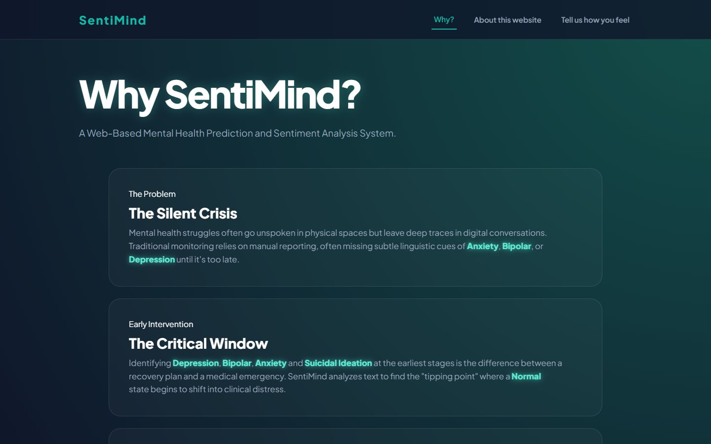
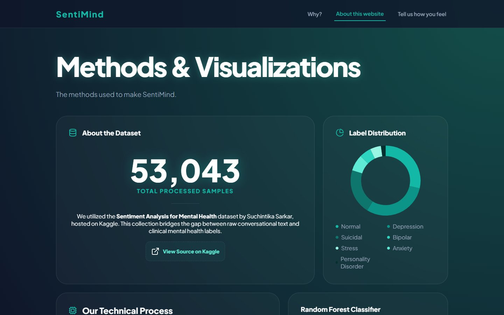
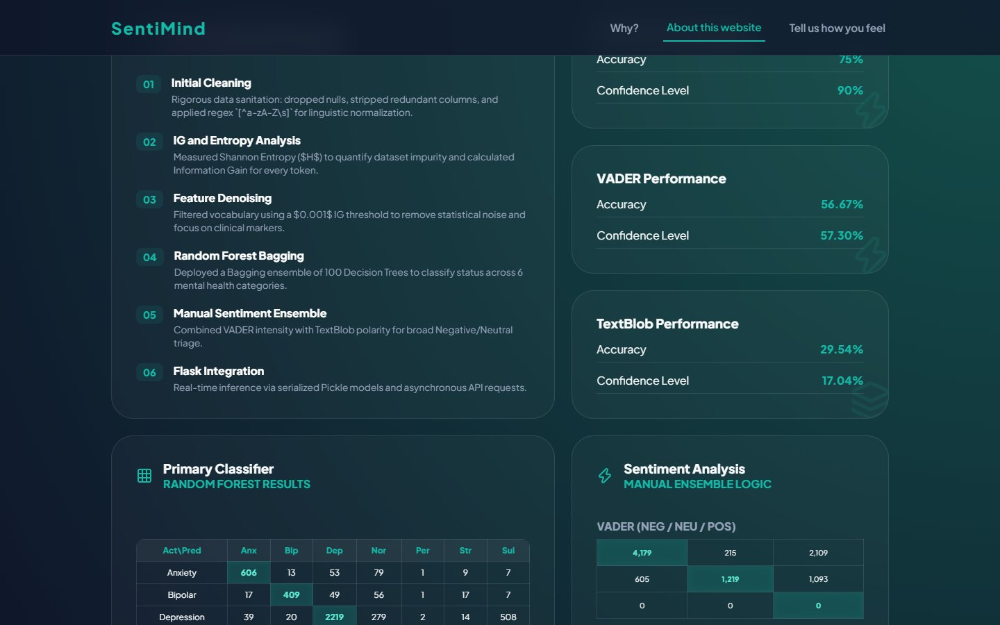
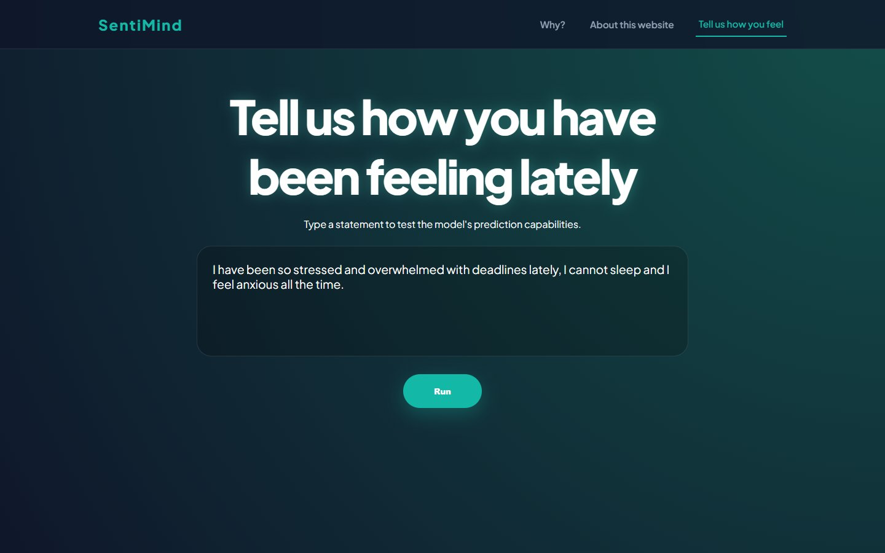
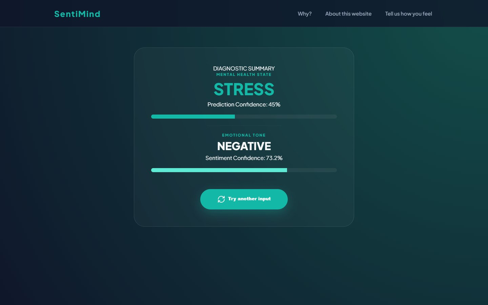

# SentiMind

A web-based mental health prediction and sentiment analysis system. You describe how you have been feeling, and SentiMind predicts the mental health state behind the text and its emotional tone, each with a confidence score.

> **Disclaimer:** SentiMind is a student project for learning purposes. It is **not** a diagnostic tool and must not replace a mental health professional. If you or someone you know is struggling, please reach out to a professional or a crisis line. In the Philippines, call the **NCMH Crisis Hotline at 1553**.



## Features

- **Mental health state prediction** across Normal and six categories: anxiety, bipolar, depression, personality disorder, stress and suicidal
- **Sentiment analysis** (positive / neutral / negative) from a weighted VADER + TextBlob ensemble
- **Confidence scores** for both predictions
- **Methods dashboard** with the dataset, label distribution, technical process and model results

## How it works

1. **Initial cleaning:** dropped nulls and redundant columns, normalized text with the regex `[^a-zA-Z\s]`
2. **Information Gain and entropy analysis:** measured Shannon entropy and the Information Gain of every token
3. **Feature denoising:** kept only tokens above a 0.001 Information Gain threshold
4. **Random Forest bagging:** an ensemble of 100 decision trees classifies the mental health state
5. **Manual sentiment ensemble:** VADER (65%) combined with TextBlob polarity (35%)
6. **Flask integration:** real-time inference through serialized models and asynchronous API requests

## Results

| Model | Accuracy |
|---|---|
| Random Forest (primary classifier) | **75%** |
| VADER | 56.67% |
| TextBlob | 29.54% |




## Try it




## Run it locally

Requires Python 3.12 or newer.

```bash
python -m venv .venv
.venv\Scripts\activate        # Windows  (macOS/Linux: source .venv/bin/activate)
pip install -r requirements.txt
python app.py
```

Then open http://127.0.0.1:5000

The trained model (`mental-health_model.pkl`) is saved with joblib compression and needs **scikit-learn 1.8.0**, as pinned in `requirements.txt`.

## Tech stack

Python · Flask · scikit-learn · VADER · TextBlob · Chart.js · HTML/CSS

## Dataset

[Sentiment Analysis for Mental Health](https://www.kaggle.com/datasets/suchintikasarkar/sentiment-analysis-for-mental-health) by Suchintika Sarkar on Kaggle (53,043 samples). The dataset is not included in this repository.

## Author

**Sabrina Chavez**, Project Lead / Lead Developer · B.S. Computer Science (Data Science and Analytics), Mapúa Malayan Colleges Laguna
